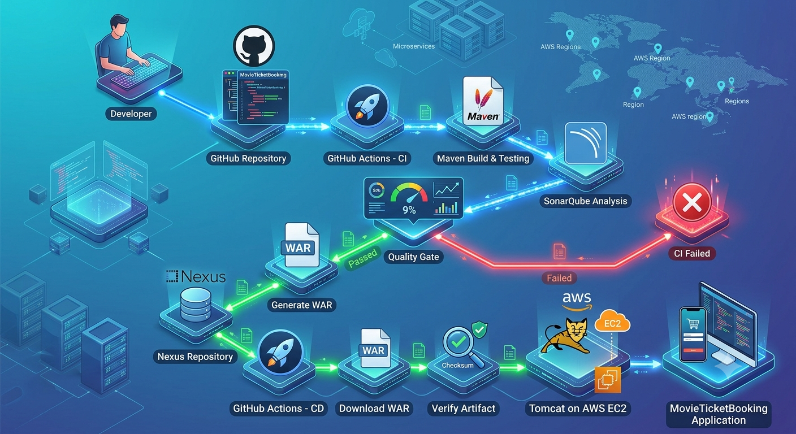
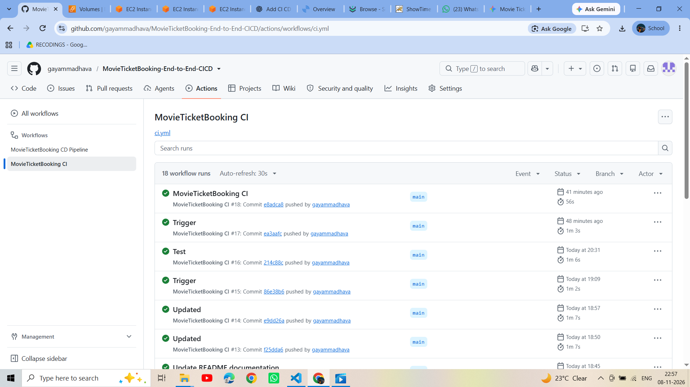
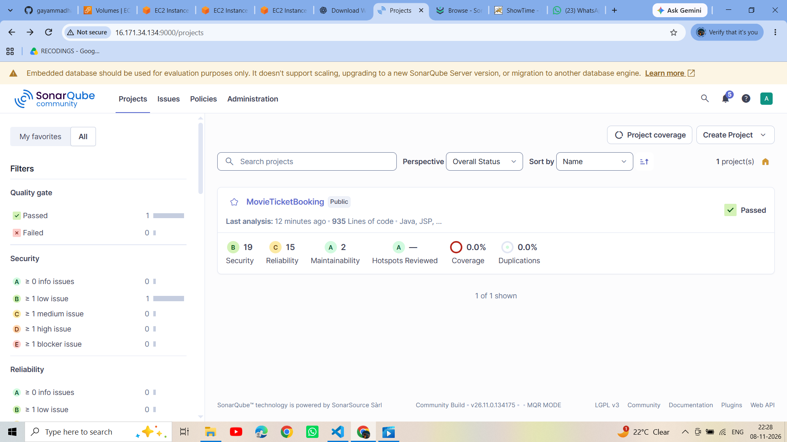
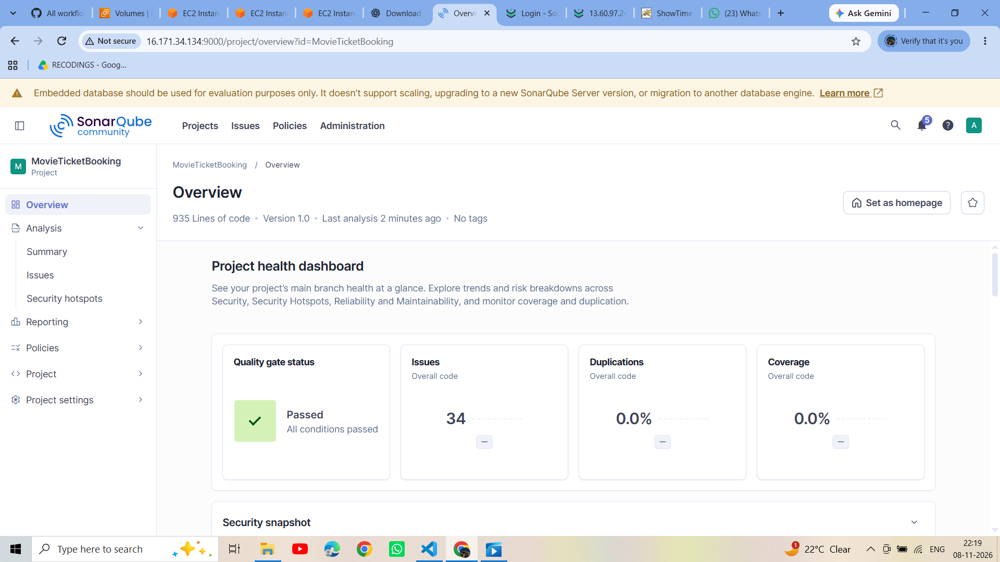
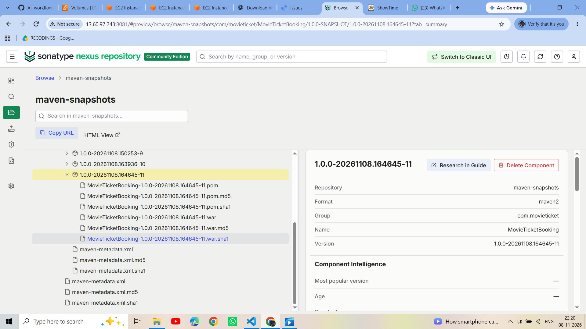
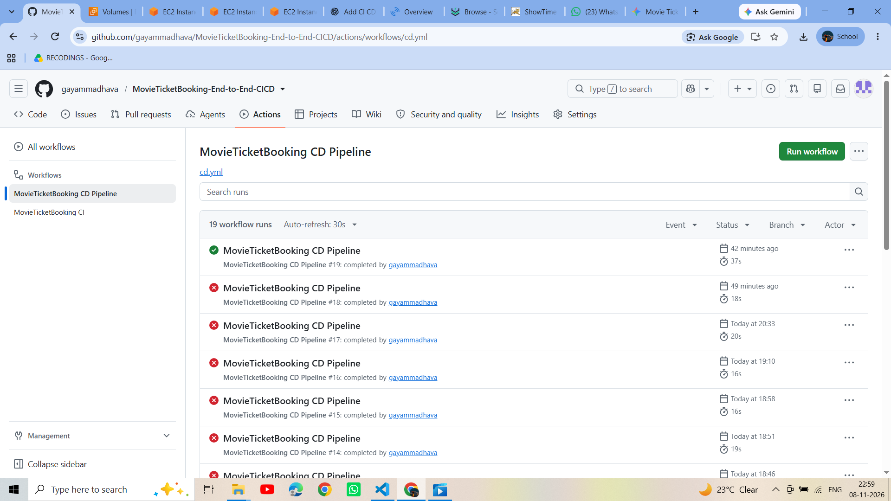
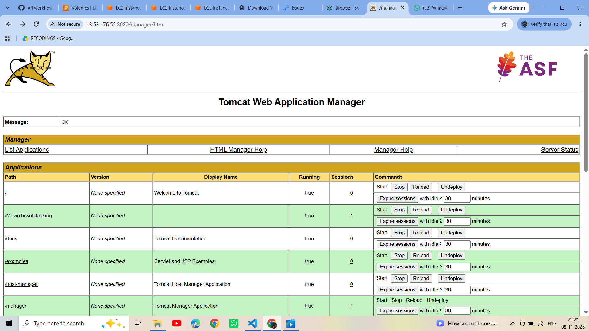
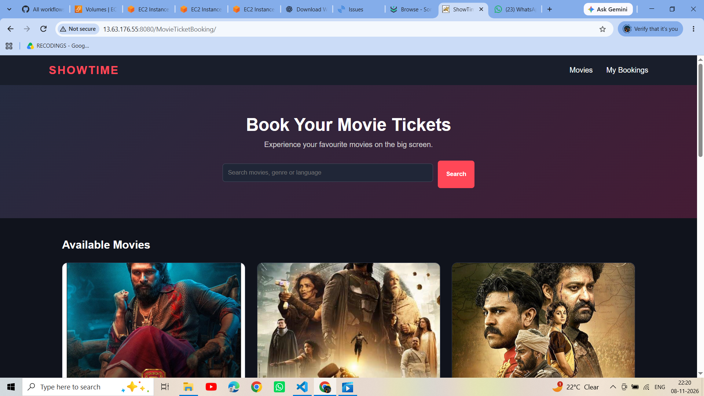

# MovieTicketBooking – End-to-End CI/CD Pipeline

<p align="center">

  
  
  
  
  
  
  

</p>

## 📌 Project Overview

MovieTicketBooking is a Java-based web application deployed through an automated End-to-End CI/CD pipeline using GitHub Actions.

This project integrates **Apache Maven, SonarQube, Sonatype Nexus Repository, and Apache Tomcat** to automate application testing, code quality analysis, artifact management, and deployment.

The CI pipeline builds and tests the application, performs SonarQube analysis, generates a WAR artifact, and uploads it to Nexus Repository.

The CD pipeline downloads the previously published WAR artifact from Nexus and deploys it to Apache Tomcat running on an AWS EC2 instance.

## 🏗️ CI/CD Architecture



## 🛠️ Technologies Used

| Technology | Purpose |
|---|---|
| Java 17 | Application development |
| Apache Maven | Build, test and package application |
| Git & GitHub | Source code management |
| GitHub Actions | CI/CD automation |
| SonarQube | Static code analysis |
| Sonatype Nexus | WAR artifact storage |
| Apache Tomcat 9 | Application deployment |
| AWS EC2 | Hosting Tomcat server |
| Ubuntu Linux | GitHub-hosted runner and server OS |
| YAML | Workflow configuration |
| CURL | Tomcat deployment API |

## 🔄 Continuous Integration (CI)

**Workflow:** `.github/workflows/ci.yml`

The CI pipeline is triggered by:

- Push to the `main` branch.
- Pull requests targeting the `main` branch.

### CI Pipeline Stages

1. **Checkout Code:** Retrieves application source code from GitHub.
2. **Setup JDK 17:** Configures Java 17 using Eclipse Temurin.
3. **Maven Testing:** Executes application tests using `mvn clean test`.
4. **SonarQube Analysis:** Performs static code analysis and checks the Quality Gate.
5. **WAR Packaging:** Generates the deployable WAR file using Maven.
6. **Configure Maven Settings:** Configures Nexus authentication.
7. **Deploy to Nexus:** Uploads the WAR artifact to the Maven Snapshot repository.

### CI Commands

**Run Maven Tests**

```bash
mvn -B clean test
```

**SonarQube Analysis**

```bash
mvn -B test org.sonarsource.scanner.maven:sonar-maven-plugin:5.5.0.6356:sonar \
  -Dsonar.host.url=$SONAR_HOST_URL \
  -Dsonar.token=$SONAR_TOKEN \
  -Dsonar.projectKey=MovieTicketBooking \
  -Dsonar.qualitygate.wait=true
```

**Generate WAR**

```bash
mvn -B clean package -DskipTests
```

**Upload WAR to Nexus**

```bash
mvn org.apache.maven.plugins:maven-deploy-plugin:3.1.4:deploy-file \
  -DgroupId=com.movieticket \
  -DartifactId=MovieTicketBooking \
  -Dversion=1.0.0-SNAPSHOT \
  -Dpackaging=war \
  -Dfile=target/MovieTicketBooking.war \
  -DgeneratePom=true \
  -DrepositoryId=nexus \
  -Durl=${NEXUS_HOST_URL}/repository/maven-snapshots/
```

### CI Artifact Details

| Property | Value |
|---|---|
| Group ID | `com.movieticket` |
| Artifact ID | `MovieTicketBooking` |
| Version | `1.0.0-SNAPSHOT` |
| Packaging | WAR |
| Repository | `maven-snapshots` |

## 🚀 Continuous Deployment (CD)

**Workflow:** `.github/workflows/cd.yml`

The CD pipeline is manually triggered using `workflow_dispatch`.

Instead of rebuilding the application, it downloads the existing WAR artifact from Nexus and deploys it to Tomcat.

### CD Pipeline Stages

1. **Checkout Code:** Checks out the GitHub repository.
2. **Setup Java 17:** Configures Java on the GitHub-hosted runner.
3. **Configure Maven Settings:** Configures Nexus credentials and HTTP repository access for the lab environment.
4. **Download WAR:** Retrieves `MovieTicketBooking-1.0.0-SNAPSHOT.war` from Nexus.
5. **Verify WAR:** Checks whether the downloaded WAR file exists and is not empty.
6. **Deploy to Tomcat:** Uses CURL and Tomcat Manager Text API to deploy the WAR.
7. **Verify Deployment:** Checks the deployed application URL.

### CD Download Command

```bash
mvn org.apache.maven.plugins:maven-dependency-plugin:3.8.1:get \
            -Dartifact=com.movieticket:MovieTicketBooking:1.0.0-SNAPSHOT:war \
            -DremoteRepositories=nexus::default::${NEXUS_HOST_URL}/repository/maven-snapshots/ \
            -Dtransitive=false
```

### WAR Verification

```bash
test -s target/nexus-download/MovieTicketBooking-1.0.0-SNAPSHOT.war
```

### Tomcat Deployment

```bash
curl --fail --show-error \
  --user "$TOMCAT_USERNAME:$TOMCAT_PASSWORD" \
  --upload-file target/nexus-download/MovieTicketBooking.war \
  "$TOMCAT_URL/manager/text/deploy?path=/MovieTicketBooking&update=true"
```

### Deployment Verification

```bash
curl --fail "$TOMCAT_URL/MovieTicketBooking/"
```

## 📦 Nexus Repository

Sonatype Nexus Repository is used as a centralized artifact repository.

The CI pipeline uploads the WAR file to Nexus, and the CD pipeline downloads the same artifact for deployment.

**Repository Configuration**

| Property | Value |
|---|---|
| Repository Format | Maven 2 |
| Repository Name | `maven-snapshots` |
| Repository Type | Hosted |
| Version | `1.0.0-SNAPSHOT` |
| Packaging | WAR |

## 🔍 SonarQube Integration

SonarQube is integrated into the CI pipeline to evaluate source code quality.

Features:

- Static code analysis.
- Bug detection.
- Code smell identification.
- Reliability and maintainability analysis.
- Quality Gate verification.

The CI workflow waits for the SonarQube Quality Gate result before continuing to WAR packaging.

## 🖥️ Tomcat Deployment on AWS EC2

Apache Tomcat 9 is installed on an AWS EC2 instance.

Tomcat Manager is configured with the `manager-script` role to allow automated deployment from GitHub Actions.

**Tomcat Manager configuration:**

```xml
<role rolename="manager-script"/>

<user username="deploy"
      password="YourStrongPassword"
      roles="manager-script"/>
```

**Application URL:**

```text
http://YOUR-EC2-IP:8080/MovieTicketBooking/
```

## 🔐 GitHub Actions Secrets

Configure these secrets under:

GitHub Repository → Settings → Secrets and variables → Actions.

| Secret | Description |
|---|---|
| `SONAR_HOST_URL` | SonarQube server URL |
| `SONAR_TOKEN` | SonarQube authentication token |
| `NEXUS_HOST_URL` | Nexus URL used in CI |
| `NEXUS_URL` | Nexus URL used in CD |
| `NEXUS_USERNAME` | Nexus username |
| `NEXUS_PASSWORD` | Nexus password |
| `TOMCAT_URL` | Tomcat server URL |
| `TOMCAT_USERNAME` | Tomcat Manager username |
| `TOMCAT_PASSWORD` | Tomcat Manager password |

## 📸 Project Screenshots

Add your actual screenshots to a folder named `screenshots/` in the repository.

### 1. GitHub Actions – CI Pipeline



### 2. SonarQube – Project Analysis



### 3. SonarQube – Quality Gate



### 4. Nexus – WAR Artifact



### 5. GitHub Actions – CD Pipeline



### 6. Tomcat – Deployed Application



### 7. MovieTicketBooking – Deployed Application



## 📂 Repository Structure

```text
MovieTicketBooking/
│
├── .github/
│   └── workflows/
│       ├── ci.yml
│       └── cd.yml
│
├── src/
│   ├── main/
│   └── test/
│
├── screenshots/
│   ├── ci-pipeline.png
│   ├── sonarqube-analysis.png
│   ├── sonarqube-quality-gate.png
│   ├── nexus-artifact.png
│   ├── cd-pipeline.png
│   └── tomcat-application.png
│
├── pom.xml
└── README.md
```

## ⭐ Key Features

- Automated CI/CD using GitHub Actions.
- Maven-based build and testing.
- SonarQube static code analysis.
- Quality Gate verification.
- Centralized WAR artifact management using Nexus.
- Artifact download without rebuilding the application.
- Automated WAR deployment using Tomcat Manager API.
- AWS EC2-based application hosting.
- Secure credential management using GitHub Secrets.

## 🎯 Conclusion

This project demonstrates a practical end-to-end DevOps implementation for a Java web application.

By integrating Maven, SonarQube, Nexus Repository, Apache Tomcat, AWS EC2, and GitHub Actions, the project automates the complete software delivery process from source code to application deployment.

It demonstrates hands-on experience with build automation, code quality management, artifact versioning, repository management, and automated deployment.

## 👨‍💻 Author

**Gayam Madhava Reddy**

Cloud & DevOps Engineer | AWS | Linux | Terraform | Docker | Kubernetes | CI/CD

- GitHub: https://github.com/gayammadhava
